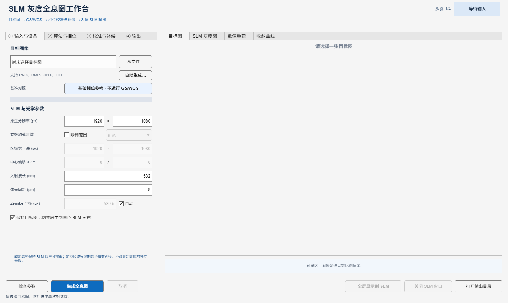
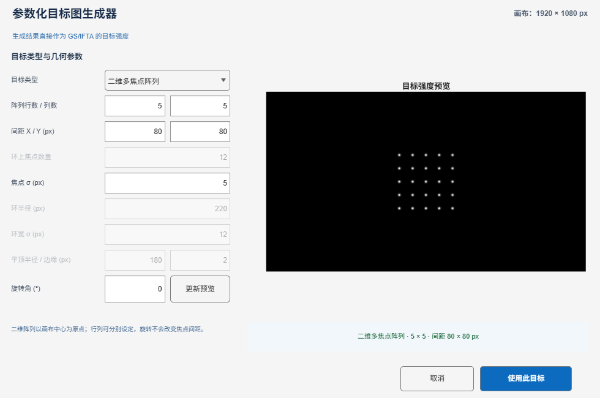
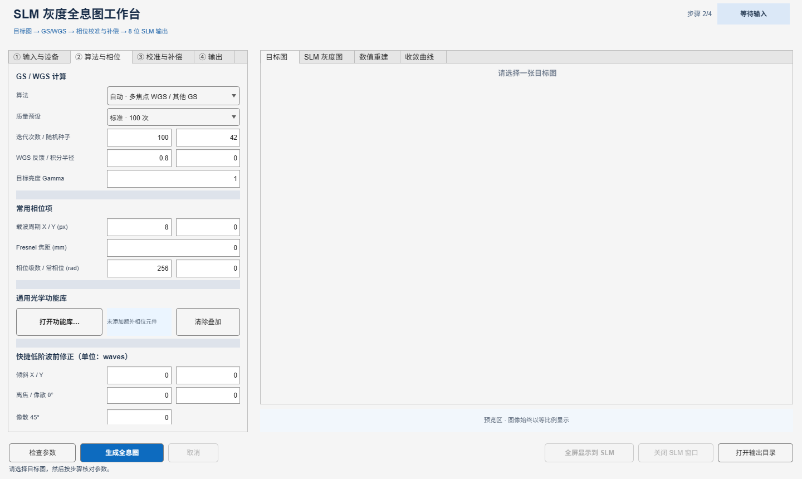
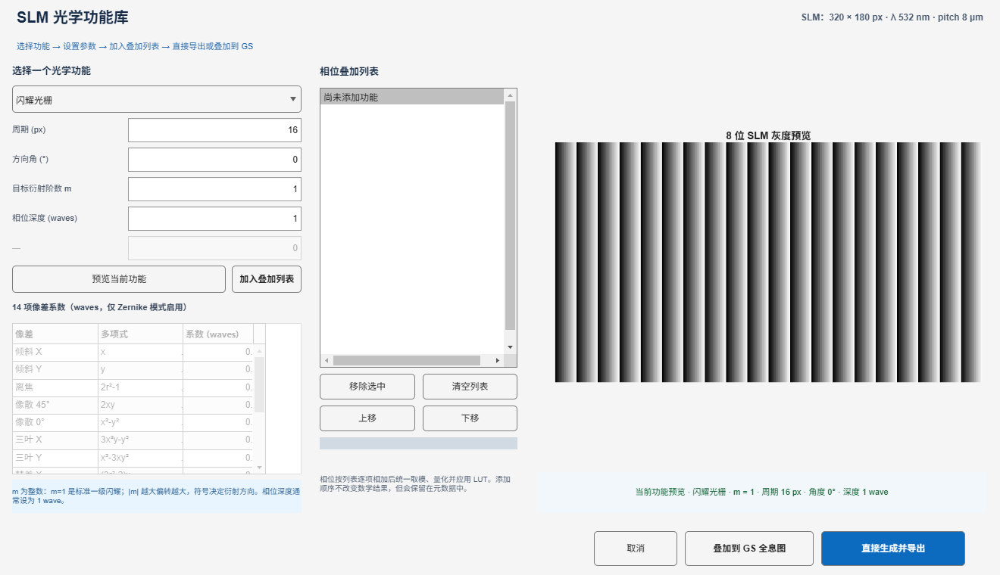

# MATLAB SLM 灰度全息图生成器

算法文献、优化前诊断、改进记录及数值对照见 [ALGORITHM_RESEARCH.md](ALGORITHM_RESEARCH.md)；后续计算方法审查、参数扫描与零级分析见 [ALGORITHM_AUDIT.md](ALGORITHM_AUDIT.md)。

这个项目能将目标灰度图转换为标准 Gerchberg–Saxton（GS）、加权 Gerchberg–Saxton（WGS）或混合区域振幅自由度（MRAF）全息图，也能直接生成常用相位元件。它包含参数化多焦点目标、逐焦点功率均匀化、14 项 Zernike 像差、光栅、透镜、轴锥/贝塞尔光、涡旋和二值相位图案，并统一经过量化、LUT 和背景补偿后输出为相位型空间光调制器（SLM）使用的 8 位单通道灰度图。

生成的 `hologram.png` 与 `hologram.bmp` 尺寸严格等于所设 SLM 原生像素数，可直接导入 SLM 控制软件。

## 推荐：交互式工作台

在 MATLAB 中切换到本目录后运行：

```matlab
app = launch_slm_hologram_app;
```



界面采用四步式导航，并保持一个大尺寸预览区：

1. 选择目标图并在右侧检查原图预览；
2. 核对 SLM 原生分辨率、波长、像元间距，并按需设置矩形/椭圆有效加载区域；
3. 可从“通用光学功能库”叠加 14 项像差、光栅、透镜、轴锥/贝塞尔光等，也可跳过 GS 直接导出相位图；
4. 可选加载实测相位 LUT、原生分辨率的入射光振幅图与背景补偿图，加入倾斜、离焦和两种像散；
5. 点击“检查参数”完成输入、LUT、补偿图和显示器分辨率预检；
6. 点击“生成全息图”，在可取消的进度窗口中查看 MSE；WGS 同时显示焦点均匀度；完成后查看最终灰度图的信号区误差与功率比例；
7. 在大预览区切换目标图、SLM 灰度图、数值重建和对数收敛曲线；确认无误后，选择扩展桌面中的 SLM 显示器并点击“全屏显示到 SLM”。按 `Esc` 关闭该显示窗口。

“快速预览 / 标准 / 高质量”预设会自动设置迭代次数；需要精细控制时选择“自定义”。Zernike 半径默认根据 SLM 尺寸自动计算，常用参数与高级波前项分别显示，减少初次使用时的干扰。

## 基础相位参考

在“① 输入与设备”中点击“基础相位参考 · 不运行迭代算法”，可生成用于实验对照的基准 SLM 图。该模式直接从均匀基础相位生成灰度输出。

参考模式会忽略：

- GS/WGS/MRAF 目标迭代；
- X/Y 载波光栅和 Fresnel 透镜；
- 快捷倾斜、离焦、像散；
- 通用光学功能库中的叠加元件。

它仍保留当前全局相位偏置、相位级数、LUT、灰度反相和背景补偿图，因此可作为与实验全息图处于相同设备校准条件下的基准。没有背景补偿且相位偏置为零时，输出是严格均匀的 8 位灰度图。

输出目录会额外生成 `reference_phase.png`，同时保留 `hologram.png/.bmp`、`phase_preview.png`、`phase_data.mat` 和标明 `output_mode: reference_phase` 的 `metadata.json`。

脚本中可这样生成：

```matlab
config = default_slm_config();
config.slm_size = [1080, 1920];
config.output_dir = fullfile(pwd, "output_reference");
config.target_description = "基础相位参考";

emptyComponents = struct("type", {}, "parameters", {}, "description", {});
[referenceGray, result] = generate_slm_phase_hologram(emptyComponents, config);
```

## 手动控制有效加载区域

“① 输入与设备”中的“有效加载区域”用于限制全息相位在 SLM 上实际参与工作的范围。可选择矩形或椭圆，分别设置宽度、高度以及相对 SLM 中心的 X/Y 偏移；X 向右为正，Y 向下为正。界面会在生成前检查区域是否越过 SLM 边界。

这里改变的是 **SLM 入射瞳孔/相位加载范围**，不是裁剪目标面的多焦点阵列，也不修改“通用光学功能库”中元件本身的尺寸、中心、焦距或周期。两者独立设置：先在功能库定义完整的光栅、透镜、轴锥、涡旋或像差相位，再由加载区域决定这些相位中的哪些像素最终参与输出。输出的 `hologram.png/.bmp` 仍严格保持 SLM 原生分辨率：

- GS/WGS/MRAF 正向传播使用该区域作为有效孔径，因此数值重建会考虑孔径尺寸和形状；
- 载波、快捷波前项和功能库相位均保持其自身的完整 SLM 坐标与参数；最终输出时只有区域内的相位保留；
- 功能库预览始终显示完整元件，便于单独检查其半径、光轴、周期和相位结构；
- 区域外回到全局相位偏置与背景补偿组成的校准基础相位；
- 每次输出 `active_region_mask.png`，白色表示参与加载的像素，便于与实物光斑或光阑核对；区域参数也写入 `metadata.json` 和 `result.active_region`。

脚本示例：

```matlab
config = default_slm_config();
config.slm_size = [1080, 1920];
config.active_region_enabled = true;
config.active_region_shape = "ellipse";       % "rectangle" 或 "ellipse"
config.active_region_size_px = [720, 1280];   % [高度, 宽度]
config.active_region_offset_px = [80, -30];   % [X,Y]；右移 80、上移 30 px

[grayHologram, result] = generate_slm_hologram(target, config);
```

重要：相位型 SLM 不能仅靠“区域外基础相位”吸收或遮断区域外的光，区域外仍会反射/透射。激光加工时应让入射光束尺寸与有效区域匹配，或使用真实振幅光阑，并重新检查焦点间距、焦斑尺寸、衍射效率和损伤阈值。

## 自动生成目标图

在“① 输入与设备”中点击“自动生成…”，无需准备外部图片即可生成：



- 二维多焦点阵列：行列数、X/Y 间距、焦点 σ 和旋转角可调；
- 环形多焦点阵列：焦点数量、环半径、焦点 σ 和起始旋转角可调；
- 单高斯光斑；
- 连续环形光束；
- 带平滑边缘的圆形平顶光斑。

生成器会先显示目标强度预览。网格和环形多焦点会保存每个焦点的亚像素中心坐标；“自动”算法对此类目标选择 WGS，对参数化连续圆环和平顶光选择 MRAF，对普通外部图像选择 GS。参数会写入 `metadata.json`，实际送入算法的目标图会另存为 `target_used.png`。如果随后修改 SLM 分辨率，参数化目标和焦点中心会一起在新画布上重建。

脚本中也可直接调用：

```matlab
p = struct("rows", 6, "columns", 8, ...
    "spacing_x_px", 70, "spacing_y_px", 70, ...
    "spot_sigma_px", 4, "rotation_deg", 0);
[target, description, parameters] = generate_slm_target( ...
    "grid", [1080, 1920], p);

config = default_slm_config();
config.slm_size = [1080, 1920];
config.target_description = description;
config.target_parameters = parameters;
generate_slm_hologram(target, config);
```

## WGS 多焦点均匀化



WGS 不仅匹配整幅目标图，还在每次傅里叶传播后测量每个焦点积分区域内的功率，并反馈更新下一轮的目标权重。工程使用的均匀度定义为：

```text
U = 1 - (Pmax - Pmin) / (Pmax + Pmin)
```

`U = 1` 表示所有焦点功率完全一致。界面的收敛页同时显示归一化 MSE 和均匀度百分比，便于识别“图像误差下降但焦点仍不均匀”的情况。

算法选择：

- `自动`：参数化网格或环形多焦点使用 WGS，连续圆环和平顶光使用 MRAF，其余目标使用 GS；
- `WGS`：强制使用逐焦点反馈；外部多焦点图会按峰值阈值自动检测焦点；
- `MRAF`：只在连续目标的信号区及其周围守护区约束振幅，在噪声区释放自由度；
- `GS`：关闭权重反馈，保留标准算法作为对照。

“WGS 反馈”建议从 `0.6–0.9` 开始，值越大修正越强；过强可能产生迭代振荡。“积分半径”单位为目标面的像素，设为 `0` 时自动采用约两倍焦点 σ。半径不宜大于相邻焦点间距的一半，否则积分区域会互相混入。

脚本示例：

```matlab
config = default_slm_config();
config.slm_size = [1080, 1920];
config.algorithm = "wgs";
config.wgs_feedback_strength = 0.8;
config.wgs_spot_radius_px = 0; % 自动
config.target_description = description;
config.target_parameters = parameters; % 包含 focus_centers_px

[grayHologram, result] = generate_slm_hologram(target, config);
fprintf("最终焦点均匀度：%.2f%%\n", 100 * result.final_spot_uniformity);
```

对于外部目标，也可通过 `config.wgs_focus_centers_px = [x1,y1; x2,y2; ...]` 提供精确中心，优先级高于自动检测。对于连续图像、圆环和平顶光束，WGS 的“离散焦点”假设不成立，应使用 MRAF 或 GS 对照。外部连续图像可显式设置 `config.algorithm = "mraf"`。

MRAF 的 `mraf_signal_threshold`（默认 `0.02`）以目标峰值为准选出信号区，`mraf_guard_px`（默认 `4`）在其周围扩展暗场守护区，`mraf_signal_fraction`（默认 `0.7`）控制信号区约束与噪声区自由度的权衡。增大守护区可能降低可用光效率，应与信号区误差一起比较。

当前实现对信号区和噪声区分别使用 `sqrt(mraf_signal_fraction)` 与 `sqrt(1-mraf_signal_fraction)` 的振幅系数；原始 MRAF 论文直接使用 `m` 与 `1-m`。两种写法可互相重参数化，数值参数不能直接与论文中的 `m` 比较。连续环的误差、信号功率与零级峰值需一起核对。

已用同一张 1080×1920 连续环目标图完成同参数数值对照：重新生成的 GS 最终灰度图的信号区 nRMSE 为 `0.138344`、信号区功率比例为 `0.855951`；MRAF 分别为 `0.048881` 和 `0.824990`。两组文件分别保存于 `output_gs_baseline/` 和 `output_optimized/`。这些是理想线性 LUT 和 FFT 模型下的数值指标，实验结果需用实测 LUT 与相机图核对。

阵列间距使用傅里叶目标网格的像素单位。若需要换算成后焦面的物理距离，需要结合外部傅里叶透镜焦距、波长、SLM 像元间距和采样点数进行换算；界面不会把 Fresnel 相位项的焦距误当成外部傅里叶透镜焦距。

## 通用光学功能库

在“② 算法与相位”中点击“打开功能库…”。窗口会即时显示当前功能或整个叠加列表经过量化后的 8 位灰度预览；再次打开时会保留尚未清除的相位叠加列表。



内置 21 类相位功能：

- 光栅：闪耀、二值、正弦、交叉二值光栅；
- 透镜：连续/二值 Fresnel 透镜、柱面 Fresnel 透镜；
- 特殊光束：连续/二值轴锥（贝塞尔型光束）、带拓扑荷的涡旋贝塞尔光、独立涡旋相位、同心二值环；
- 二值相位图案：圆形/矩形孔径、单缝、双缝、水平/垂直二分屏；
- 校准与测试：均匀相位、随机连续相位、随机二值相位；
- 像差：14 项 Zernike 波前，包括 X/Y 倾斜、离焦、0°/45° 像散、X/Y 三叶、X/Y 彗差、球差、二级 0°/45° 像散和 X/Y 四叶。

Zernike 系数单位为 `waves`，`1 wave = 2π rad`；圆形瞳孔外的像差相位为零。轴锥以“径向 2π 周期（像素）”控制径向相位斜率，可叠加整数拓扑荷生成涡旋贝塞尔型光束。所谓孔径和狭缝是二值**相位**图案，不等同于真实的振幅遮挡。

闪耀光栅以“目标衍射阶数 `m`”作为主控制量：`m = 1` 为标准一级闪耀，正负号决定偏转方向，`|m|` 增大时输出角度按阶数增大。`周期 (px)` 仍设定基准空间周期；`相位深度`建议先设为 `1 wave`，再结合实测 LUT 和一级衍射效率微调。旧项目中保存的“相位跨度”会自动作为相位深度兼容读取。

窗口提供两条独立工作流：

- “叠加到全息图”：多个元件先以未包裹相位相加，再与迭代算法结果叠加，最后统一取模、量化并应用 LUT；
- “直接生成并导出”：不需要目标图和迭代，适合光栅、透镜、贝塞尔光、涡旋和像差校准图；仍会应用全局相位偏置、背景补偿、量化、反相和 LUT。

脚本中可直接组合元件：

```matlab
config = default_slm_config();
config.slm_size = [1080, 1920];
config.output_dir = fullfile(pwd, "output_direct");

z = zeros(14, 1);
z(8) = 0.15; % X 彗差，0.15 wave
components = struct( ...
    "type", {"blazed_grating", "axicon", "zernike14"}, ...
    "parameters", { ...
        struct("period_px", 12, "angle_deg", 0, "diffraction_order", 1, "phase_depth_waves", 1), ...
        struct("radial_period_px", 28, "vortex_charge", 1), ...
        struct("zernike_coefficients_waves", z)});

[grayHologram, result] = generate_slm_phase_hologram(components, config);
```

这一步不会调用厂商 SDK 或自动识别设备；它把选定的显示器当作 SLM 输出窗口。因此必须在操作系统中把 SLM 配置为 **扩展桌面**，并明确选择真实 SLM 所在显示器。生成的 PNG/BMP 始终是更可靠的可追溯交付物。

## 脚本方式

在 MATLAB 中切换到本目录后运行：

```matlab
demo_generate_hologram
```

这会以合成目标图为例，在 `output_demo` 目录生成全息图。使用自己的目标图：

```matlab
config = default_slm_config();
config.slm_size = [1080, 1920];       % [高度, 宽度]，必须是 SLM 物理分辨率
config.iterations = 150;
config.grating_period_x_px = 8;       % 一级衍射载波；设为 0 则关闭
config.output_dir = fullfile(pwd, "output");

[grayHologram, result] = generate_slm_hologram("target.png", config);
```

`grayHologram` 是 `uint8` 的二维数组，`result` 包含量化相位、数值重建预览和每次迭代的 MSE。

## 生成文件

- `hologram.png`：8 位单通道 PNG，优先用于加载到 SLM
- `hologram.bmp`：同一图像的无损 BMP 副本
- `active_region_mask.png`：有效加载区域核对图；白色为参与加载的 SLM 像素
- `target_used.png`：本次 GS/IFTA 实际使用的目标强度图
- `reconstruction_preview.png`：从最终灰度码经 LUT 回推相位、移除载波后，与目标对齐的理想傅里叶数值重建
- `reconstruction_full.png`：从最终灰度码计算、保留载波位移的完整傅里叶面预览
- `metadata.json`：生成参数和最终数值误差
- `convergence.csv`：每轮迭代的 MSE 和 WGS 焦点均匀度，可直接用 MATLAB/Excel 分析

直接相位工作流还会生成：

- `phase_preview.png`：包裹相位的线性 8 位预览，不代替 LUT 映射后的 `hologram.png`
- `phase_data.mat`：未丢失浮点精度的相位数据和元件参数
- `reference_phase.png`：仅在基础相位参考模式中生成的明确命名副本

在控制软件中应以 **1:1 像素、无缩放、无色彩校正、无额外 Gamma 处理** 显示图像。若操作系统桌面缩放不是 100%，请确认窗口仍以 SLM 原生像素输出。

## 标定 LUT（真实实验必须关注）

默认映射为线性 `0…2π -> 0…255`，它只适合数值验证。实际 SLM 的灰度—相位响应通常非线性，且依赖波长、偏振、入射角与驱动模式。建议为每个实验条件测量相位 LUT，并设置：

```matlab
config.phase_lut_file = "calibration/phase_lut.csv";
```

CSV 的列标题必须是 `phase_rad,gray`，相位按递增顺序覆盖 0 至至少 `2*pi`：

```csv
phase_rad,gray
0.000000,0
0.785398,31
1.570796,72
3.141593,151
4.712389,215
6.283185,255
```

其中 `gray` 是 SLM 要显示的 0–255 灰度码，必须严格单调，以便从最终导出的灰度码反推相位进行数值重建。代码按相位插值；LUT 覆盖范围不足一个完整 `2π` 时会报错。反推相位只是基于 LUT 的估计，不能代替实拍验证。

## 主要参数

| 配置字段                                                               | 含义                                                                     |
| ------------------------------------------------------------------ | ---------------------------------------------------------------------- |
| `slm_size`                                                         | `[高度, 宽度]`，SLM 的实际物理像素数。                                               |
| `active_region_enabled`                                            | 是否启用手动有效加载区域；输出画布尺寸不会改变。                                               |
| `active_region_shape`                                              | `"rectangle"` 或 `"ellipse"`。                                           |
| `active_region_size_px`                                            | `[高度, 宽度]`，有效区域尺寸；空值表示整幅 SLM。                                          |
| `active_region_offset_px`                                          | `[X,Y]`，有效区域相对 SLM 中心的整数像素偏移。                                          |
| `iterations`                                                       | GS/WGS/MRAF 迭代次数，建议从 100–300 起。                                        |
| `algorithm`                                                        | `"auto"`、`"wgs"`、`"mraf"` 或 `"gs"`；自动模式对参数化多焦点采用 WGS，对连续环和平顶目标采用 MRAF。 |
| `mraf_signal_threshold` / `mraf_guard_px` / `mraf_signal_fraction` | MRAF 信号区阈值、守护宽度和信号约束权重。                                                |
| `illumination_amplitude_file`                                      | 原生尺寸的入射光**振幅**图；未设置时假定均匀入射。强度测量图需先取平方根再使用。                             |
| `wgs_feedback_strength`                                            | WGS 权重反馈强度，范围 `(0,1]`，默认 `0.8`。                                        |
| `wgs_spot_radius_px`                                               | 焦点功率积分半径，`0` 表示根据目标焦点 σ 自动计算。                                          |
| `wgs_focus_centers_px`                                             | 可选的 `N×2` 焦点中心 `[x,y]`，用于外部多焦点目标。                                      |
| `grating_period_x_px/y_px`                                         | X/Y 方向载波周期（单位：SLM 像素）；例如 `8` 表示 8 像素一个 `2π` 周期。                        |
| `target_gamma`                                                     | 输入目标亮度预校正，必须大于 0。                                                      |
| `preserve_aspect`                                                  | 是否保持输入图比例并置于黑色画布中央。                                                    |
| `phase_levels`                                                     | 相位均匀量化级数，范围 2–256。                                                     |
| `invert_grayscale`                                                 | 若 SLM 的灰度与相位方向相反，设为 `true`。                                            |
| `phase_offset_rad`                                                 | 整幅相位偏移，单位为弧度。                                                          |
| `background_phase_map_file`                                        | 原生分辨率的 8 位背景补偿相位图；不自动缩放，以避免破坏像差标定。                                     |
| `tilt_x_cycles/y_cycles`                                           | 叠加在整幅 SLM 上的线性相位周期数。                                                   |
| `fresnel_focal_length_mm`                                          | Fresnel 透镜焦距（mm），`0` 禁用；正负号对应相反二次相位，应按实际反射/透射光路确认。                     |
| `defocus_waves`、`astigmatism_*_waves`                              | 低阶 Zernike-like 相位叠加项，单位为 waves。                                       |

## 与 HOLOEYE Pattern Generator 手册的对应

本工程参考随附的 `HES2012.pdf`（SLM Pattern Generator Manual v3.3）的功能逻辑，但没有复制其软件或 SDK。

| 手册中的工作流                           | 本工程的实现                                                           |
| --------------------------------- | ---------------------------------------------------------------- |
| 启动时确认光学参数（波长、Zernike 半径）          | 工作台将波长、像元间距、Zernike 半径置于生成前面板，并保存到 `metadata.json`。              |
| Image Window 与 IFTA/DOE 进度        | 目标图选择、保持比例预览、GS/WGS/MRAF 进度、可取消计算、重建强度、MSE 和焦点均匀度曲线。             |
| 一阶/二阶相位叠加                         | 载波光栅、倾斜、离焦、0°/45° 像散均以明确的 cycles/waves 单位叠加。                     |
| 14 项像差与可叠加图案                      | 14 项 Zernike 系数表、21 类相位功能、实时预览、重排/移除和统一相位合成。                     |
| Grating、Lens、Axicon 等快捷图案         | 闪耀/二值/正弦/交叉光栅、Fresnel/柱面透镜、贝塞尔轴锥、涡旋及常用二值相位图案。                    |
| 灰度循环、反相和 Gamma 设置                 | 使用物理上更直接的全局相位、反相以及实测 `phase_rad,gray` LUT；目标 Gamma 与相位标定分离，避免混淆。 |
| Background Compensation Phase Map | 严格接受与 SLM 原生尺寸相同的灰度相位图，0–255 映射到 0–2π，并在量化前叠加。                   |
| 图案窗口中的加载区域控制                      | 保持原生输出画布，提供矩形/椭圆孔径、尺寸与中心偏移，并导出独立区域掩膜。                            |
| Extended Desktop 上的全屏 SLM 窗口      | 显示器选择器与无菜单输出窗口；需要操作者确认所选屏幕、1:1 显示和显示链路。                          |

手册中原软件对 DOE 信号图设置了 400×400 的限制。本工程不沿用该限制，而是以 SLM 原生网格计算；高分辨率和较多迭代会相应增加运行时间与内存消耗。

## 光路提示

1. 入射光应具有与 SLM 标称方向一致的偏振，且照明覆盖所用有效孔径。
2. 初次实验可用 `grating_period_x_px = 8`，在傅里叶面用光阑选择一级衍射光；再根据像元间距、透镜焦距和光阑调整周期。
3. 零级光、鬼像或亮度不均通常首先与 LUT、偏振、入射角和系统像差有关；仅增加 GS 迭代次数通常不能解决。
4. 目标内容宜留出黑色边缘，减少 FFT 周期边界引起的重叠。

## 自测

```matlab
selftest
```

自测使用小尺寸合成目标检查基础相位参考、矩形/椭圆有效加载区域及越界保护、WGS 自动选择、MRAF 环形目标与 GS 的同条件比较、最终灰度预览回算、入射振幅图、五类参数化目标、全部 21 类相位元件、14 项像差、相位叠加、直接导出、LUT 和背景补偿。它不需要 Image Processing Toolbox。

## 范围

本项目面向相位型 SLM，不包含厂商显示 SDK、实时相机闭环、多平面传播优化或设备专用的自动标定采集程序。它不会把相位孔径误当成振幅调制；涉及振幅整形时需结合编码方法或额外光学器件。上述设备特定能力可在现有相位生成、LUT、背景补偿和显示器输出接口上继续扩展。
